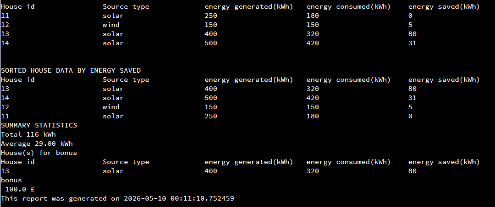
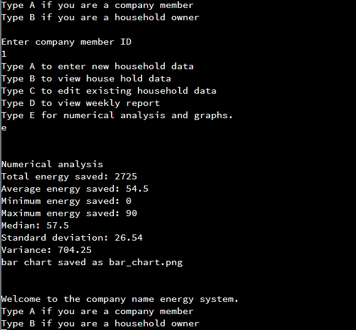
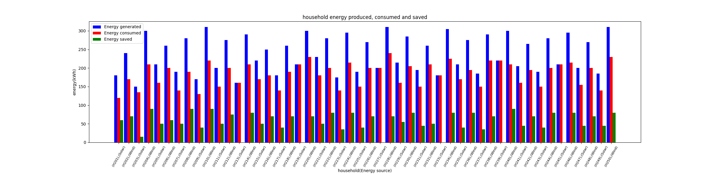

# Household Energy Tracking System (Python)

A command-line program that tracks weekly energy generation and consumption for households with solar or wind power, ranks them by energy saved, and awards a bonus to the top saver(s). Built as my Foundation Computing coursework at City St George's, University of London (International Study Centre), March 2026.

## What it does

**Company members** (log in with a member ID) can:
- add, view and edit weekly household data (house ID, energy source, kWh generated and consumed)
- generate a weekly report with households sorted by energy saved, plus total and average savings
- see which household(s) earn the £1.25/kWh bonus, including **ties** for first place and the all-zero edge case
- run numerical analysis on historical data (total, mean, min, max, median, variance, standard deviation) and produce a bar chart

**Household owners** (log in with a house ID) can view their own generation, consumption, savings and bonus eligibility.

## Python skills demonstrated
- Functions to avoid repeated code (report formatting, validation, totals)
- Nested dictionaries as the data store
- A **bubble sort written by hand** (no `sorted()`), working on nested dictionaries
- Input validation loops and `try`/`except`
- Edge-case handling (ties, zero savings, duplicate IDs)
- NumPy for statistics and Matplotlib for charts
- Systematic testing: normal, boundary and invalid cases

## Run it

```bash
pip install -r requirements.txt
python energy_system.py
```

Sample company member IDs: `1` to `8`. Sample household IDs: `11` to `14`.
Option `E` reads `dataset_file.txt` (space-separated columns: house ID, source, generated, consumed, saved). The file included here is **synthetic sample data**.

## Screenshots

| Report with sorting and bonus | Numerical analysis |
|---|---|
|  |  |



Flowcharts of the program design are in `screenshots/design_*.png`.

## Testing

I tested normal, boundary and invalid inputs (negative numbers, text, wrong energy source, duplicate house IDs, ties, all-zero savings). Bugs found and fixed this way include bonuses being awarded when every household saved 0 kWh, and unvalidated input being stored.

## Known limitations (and what I'd do next)

I documented these in my evaluation, and they are the first things I'd improve in a second version:
- Data is not saved between runs (add file/database storage)
- Household IDs are the only login, so owners could guess another ID (add passwords)
- The bubble sort depends on consecutive numeric keys, which is why there is no delete function (store records in a list)
- Only one `try`/`except`; error handling should be broader
- Report is aligned text rather than a true table
- Starter data in the code is hard-coded for testing

## Author
Theanesh Jeyaratnam
